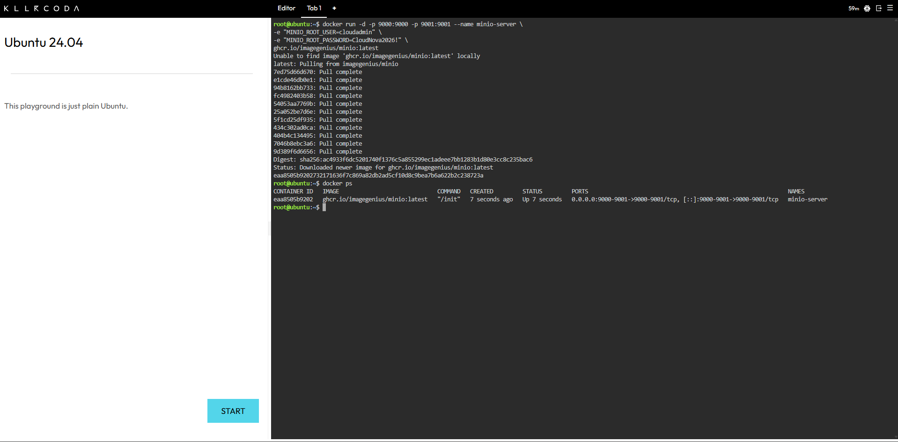
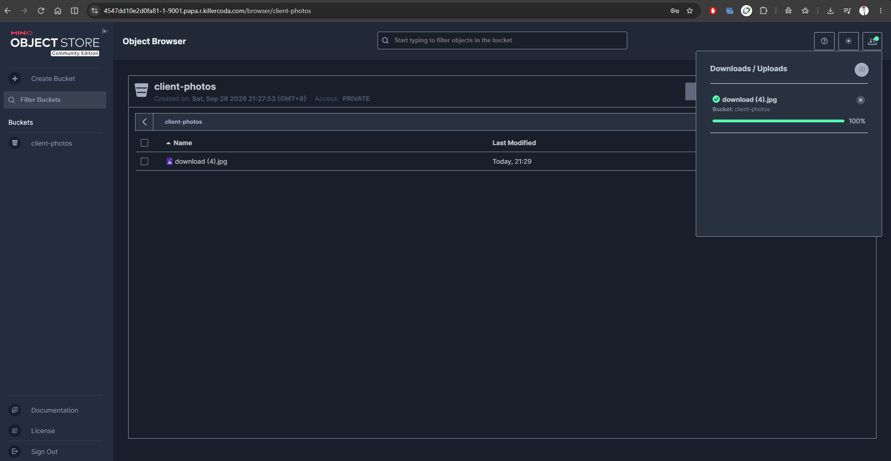

<div align="center">

# MinIO Object Storage Deployment

**Laboratory 5: The Cloud Data Engineer**
CCM101 Cloud Computing | University of Eastern Pangasinan

</div>

---

## Deployment Summary

| Field | Details |
| :--- | :--- |
| **Service** | MinIO (S3-compatible object storage) |
| **Environment** | KillerCoda Ubuntu 24.04 Playground |
| **Container Name** | `minio-server` |
| **Image** | `ghcr.io/imagegenius/minio:latest` |
| **API Port** | `9000` |
| **Web Console Port** | `9001` |
| **Bucket Created** | `client-photos` |
| **Status** | Deployed and verified |

> [!NOTE]
> The official `minio/minio` image is no longer available on Docker Hub, since MinIO stopped distributing free images there in late 2025. This deployment uses a community-maintained image that exposes the same ports and honors the same environment variables.

---

## 1. Deployment Command

```bash
docker run -d -p 9000:9000 -p 9001:9001 --name minio-server \
-e "MINIO_ROOT_USER=cloudadmin" \
-e "MINIO_ROOT_PASSWORD=CloudNova2026!" \
ghcr.io/imagegenius/minio:latest
```

### Command Breakdown

| Flag | Purpose |
| :--- | :--- |
| `-d` | Runs the container in detached (background) mode. |
| `-p 9000:9000` | Maps the S3 API port from the host to the container. |
| `-p 9001:9001` | Maps the web console port from the host to the container. |
| `--name minio-server` | Assigns a readable name for managing the container. |
| `-e` | Passes an environment variable into the container at startup. |

---

## 2. Environment Variables

| Variable | Value | Function |
| :--- | :--- | :--- |
| `MINIO_ROOT_USER` | `cloudadmin` | Admin username for the web console and API requests. |
| `MINIO_ROOT_PASSWORD` | `CloudNova2026!` | Admin password paired with the username. |

Passing credentials this way lets the container receive its configuration at runtime without modifying the image.

> [!WARNING]
> These credentials are the placeholder values from the lab specification. A real deployment would use a strong, unique password stored in a secrets manager and never committed to a repository.

---

## 3. Verification

| Step | Action | Expected Result |
| :---: | :--- | :--- |
| 1 | Run `docker ps` | `minio-server` listed with status `Up` |
| 2 | Open port `9001` through the KillerCoda Traffic Port Accessor | MinIO login page loads |
| 3 | Log in with `cloudadmin` | Object Browser opens |
| 4 | Create a bucket named `client-photos` | Bucket appears in the sidebar |
| 5 | Upload a sample image | File listed inside the bucket at 100% |

---

## 4. Bucket Configuration

| Property | Value |
| :--- | :--- |
| **Name** | `client-photos` |
| **Access** | Private |
| **Test Object** | Sample image file |
| **Purpose** | Proof-of-concept storage for user-uploaded photos |

---

## 5. Evidence

<div align="center">

**Figure 1.** MinIO container deployed and running



**Figure 2.** `client-photos` bucket with uploaded file



</div>
