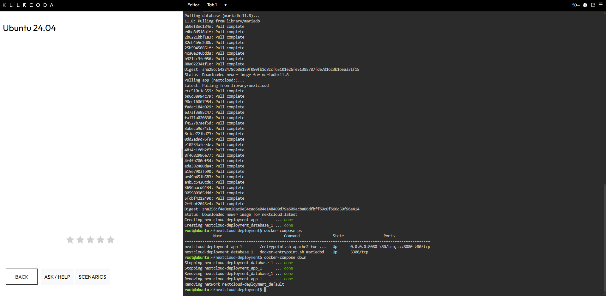

# Laboratory 6: Cloud Deployment Engineer

**Mission 6: Multi-Tier Deployment with Docker Compose**
CCM101 Cloud Computing | University of Eastern Pangasinan

---

## Deployment Summary

| Field | Details |
| :--- | :--- |
| **Client Scenario** | University replacing Google Drive with a private cloud storage system |
| **Application** | Nextcloud |
| **Architecture** | Two-tier: web/application tier and database tier |
| **Services** | `app` (Nextcloud) and `database` (MariaDB 11.8) |
| **Published Port** | `8080` mapped to container port `80` |
| **Orchestration** | Docker Compose 1.29.2 (standalone `docker-compose`) |
| **Environment** | KillerCoda Ubuntu Playground |
| **Status** | Deployed, verified in the browser, and torn down |

> [!NOTE]
> Two changes were made to the specification's Compose file. The database image is `mariadb:11.8` instead of `mariadb:10.6`, because MariaDB 10.6 reached end of life on 6 July 2026 and the current Nextcloud release no longer supports it. The optional `version` line was also left out. Details are in [docker-compose-guide.md](docker-compose-guide.md).

---

## Mission Overview

CloudNova Technologies asked for a proof-of-concept private cloud storage system for a university client. Nextcloud needs a database to store user credentials and file metadata, so the deployment uses a two-tier architecture. A MariaDB container holds the data, and a Nextcloud container serves the web interface.

Rather than starting each container by hand, both services are defined in a single `docker-compose.yml` file, and the whole stack is deployed with one command. This lab marks the move from typing individual commands to writing Infrastructure as Code.

---

## Objectives

- Explain the concept of a multi-tier application architecture.
- Understand the purpose and structure of a `docker-compose.yml` file.
- Use a Linux command-line text editor (nano) to create configuration files.
- Deploy a multi-container application (Nextcloud and a database) using Docker Compose.
- Document deployment procedures and Infrastructure as Code principles using Markdown.
- Continue expanding a professional GitHub Cloud Computing Portfolio.

---

## Commands Executed

| Step | Command | What It Did |
| :---: | :--- | :--- |
| 1 | `mkdir nextcloud-deployment` | Created a project folder for the deployment. |
| 2 | `cd nextcloud-deployment` | Moved into the project folder. |
| 3 | `docker compose version` | Tried the Compose plugin command, which this KillerCoda machine did not recognize. |
| 4 | `docker-compose version` | Confirmed that standalone Docker Compose 1.29.2 is installed. |
| 5 | `nano docker-compose.yml` | Opened the nano editor to write the Compose file. |
| 6 | `cat docker-compose.yml` | Printed the file to check that the indentation was correct. |
| 7 | `docker-compose config` | Validated the YAML and printed the parsed configuration. |
| 8 | `docker-compose up -d` | Pulled both images, created the network, and started both containers in the background. |
| 9 | `docker-compose ps` | Listed the containers and confirmed that both were running. |
| 10 | `docker-compose down` | Stopped and removed both containers and the network. |

After deployment, port 8080 was opened through KillerCoda's Traffic / Ports feature to view the Nextcloud setup page.

---

## Skills Learned

- Describing the roles of the web/application tier and the database tier in a two-tier architecture.
- Writing a multi-service `docker-compose.yml` file with correct YAML indentation.
- Creating and editing configuration files with nano on a Linux terminal.
- Connecting two containers by service name through the `MYSQL_HOST` environment variable.
- Deploying and tearing down a whole container stack with `docker-compose up -d` and `docker-compose down`.
- Checking whether a vendor image named in a lab specification is still supported, and replacing it when it is not.
- Documenting Infrastructure as Code clearly in Markdown, with screenshots as evidence.

---

## Deliverables

| File | Description |
| :--- | :--- |
| [multi-tier-architecture.md](multi-tier-architecture.md) | Defines the two-tier architecture and why the tiers are separated. |
| [docker-compose-guide.md](docker-compose-guide.md) | Documents the Compose file, how the containers find each other, and `docker run` compared with Compose. |
| [reflection.md](reflection.md) | Mission reflection. |
| `screenshots/` | Evidence of the deployment, the Nextcloud page, and the teardown. |

---

## Evidence

**Figure 1.** Stack deployment output and running containers

**Figure 2.** Nextcloud setup page in the browser

**Figure 3.** Stack teardown output

