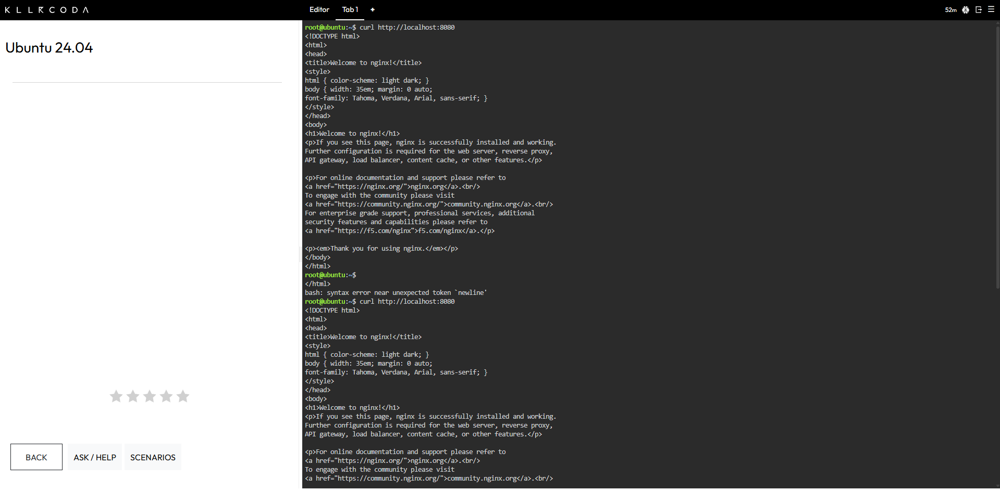
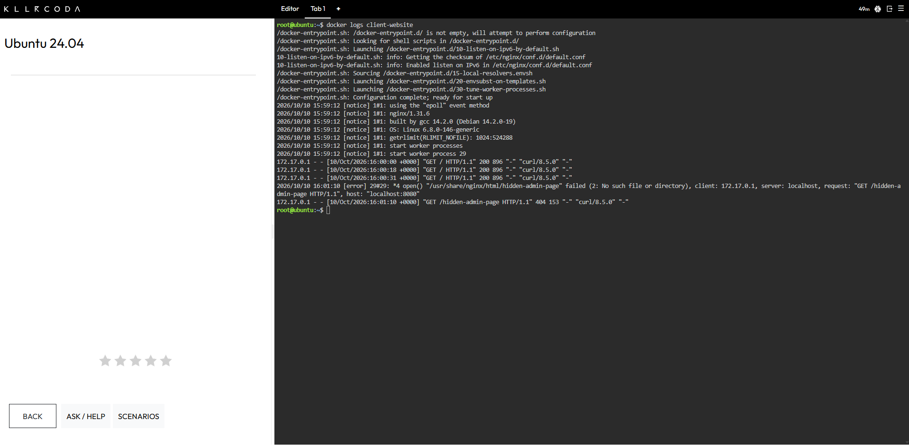
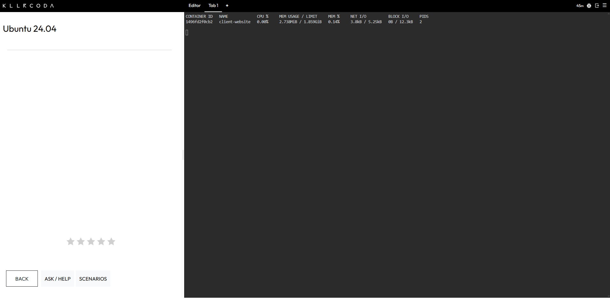

# Laboratory 07: Cloud Operations Engineer

**CCM101 Cloud Computing | University of Eastern Pangasinan | Mission 7**

---

## Executive Summary

CloudNova Technologies is preparing a large marketing campaign for a client's website, and the client is concerned that the cloud servers could run out of memory when thousands of users visit at once. As a member of the Cloud Operations Team, I performed a baseline health check on the host server, deployed the client's Nginx web server, sent test traffic to it, and reviewed its logs and live metrics.

At baseline, the host has ample free memory, storage, and CPU capacity, and the Nginx container uses very little memory. These readings were taken while the system was idle, so they show current headroom but do not prove how the server will behave under campaign-level traffic. A load test is the recommended next step.

---

## Mission Overview

This lab focuses on observability. Instead of assuming the application works, I collected evidence from three sources: the host operating system, the container's access logs, and the container's real-time metrics. I then recorded the results in Markdown reports with screenshots as supporting evidence.

---

## Objectives

- Use native Linux command-line tools to monitor host CPU, memory, and disk capacity.
- Deploy a web container and track its real-time performance using Docker metrics.
- Generate web traffic and extract application access logs for analysis.
- Translate raw performance data into a readable technical report using Markdown.
- Continue expanding a professional GitHub Cloud Computing Portfolio.

---

## Mission Workflow

| Stage | Activity | Outcome |
|---|---|---|
| **1. Host Baseline** | I checked memory, disk, and CPU on the host server. | The host showed ample free capacity while idle. |
| **2. Deployment** | I started a named Nginx container with a port mapping. | The `client-website` container was running on port 8080. |
| **3. Traffic Simulation** | I sent three valid requests and one request to a page that does not exist. | The logs recorded three 200 responses and one 404 response. |
| **4. Log Analysis** | I printed the container logs and filtered them with `grep`. | The single 404 line was isolated from the rest of the log. |
| **5. Live Metrics** | I viewed the container's resource use with `docker stats`. | The container used 2.738 MiB of memory and 0.00% CPU while idle. |

---

## Monitoring Commands Executed

| Command | What It Did |
|---|---|
| `free -h` | Displayed the host's total, used, and available memory in readable units. |
| `df -h /` | Displayed the size, used space, and available space of the root file system. |
| `top` | Opened a live view of running processes and CPU load, which I watched for 5 seconds before exiting with `q`. |
| `docker run -d --name client-website -p 8080:80 nginx` | Started an Nginx container named `client-website` in the background and mapped host port 8080 to container port 80. |
| `docker ps` | Listed the running containers and confirmed that `client-website` was up. |
| `curl http://localhost:8080` | Sent a request to the home page, which I ran three times to simulate three visitors. |
| `curl http://localhost:8080/hidden-admin-page` | Requested a page that does not exist in order to trigger a 404 error. |
| `docker logs client-website` | Printed the container's application logs, which show the three 200 requests and the one 404 request. |
| `docker logs client-website 2>&1 \| grep " 404 "` | Filtered the logs down to the single line that records the 404 error. |
| `docker stats` | Displayed a live view of the container's CPU, memory, network, and disk use. |

---

## Key Findings

| Area | Result |
|---|---|
| **Host Memory** | The host has 1.9 GiB of total memory, and about 407 MiB was in use at baseline. |
| **Host Storage** | The root file system is 19 GB in size, with 5.5 GB used and 13 GB available. |
| **Host CPU** | The host was about 99.3% idle with a load average of 0.00 at baseline. |
| **Application Logs** | The container served three requests with status 200 and one request with status 404. |
| **Container Metrics** | The `client-website` container used 2.738 MiB of memory and 0.00% CPU while idle. |

**Limitation:** These readings were taken while the system was idle. They describe a baseline, not the server's behavior under heavy load.

---

## Challenges Encountered

While sending the three requests, a stray pasted line caused one `bash: syntax error` message in the terminal. It did not send any HTTP request, and the container logs confirm exactly three 200 responses and one 404 response, so the results were not affected.

---

## Skills Learned

- Reading host memory, disk, and CPU health with `free`, `df`, and `top`.
- Deploying a named Nginx container with a port mapping using `docker run`.
- Generating test traffic and an intentional HTTP error with `curl`.
- Finding specific status codes in container logs with `docker logs` and `grep`.
- Reading real-time CPU, memory, and network figures with `docker stats`.
- Recording baseline measurements in clear Markdown reports with screenshots as evidence.
- Telling the difference between logs, which show what happened, and metrics, which show how hard the system is working.

---

## Deliverables

| File | Description |
|---|---|
| [system-baseline-report.md](system-baseline-report.md) | Records the host's memory, storage, and CPU baseline. |
| [container-observability.md](container-observability.md) | Records the 404 log line and the container's memory and CPU use. |
| [reflection.md](reflection.md) | Contains the mission reflection. |
| `screenshots/` | Holds the evidence for the host checks, deployment, traffic, logs, and metrics. |

---

## Evidence

### Host Memory Check

### Host Disk Check

### Nginx Deployment

### Successful Requests

### Failed Request

### Container Logs

### Container Metrics

