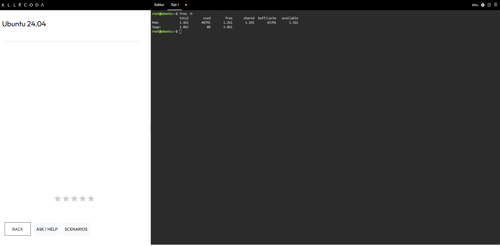
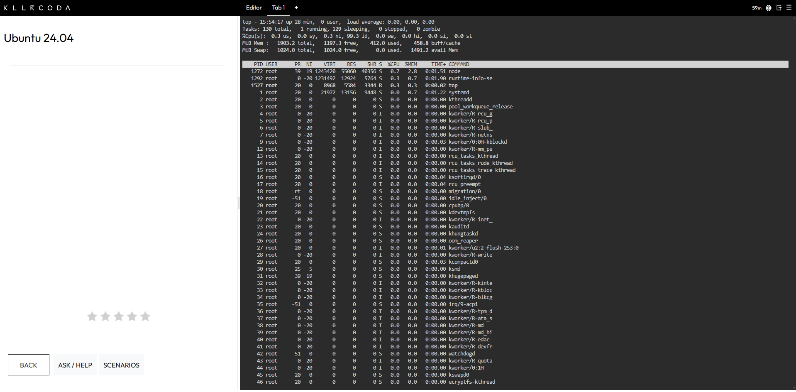

# System Baseline Report

**CCM101 Cloud Computing | Laboratory 07: Cloud Operations Engineer**

---

## Summary of Findings

| Area | Result |
|---|---|
| **Memory** | About 407 MiB of 1.9 GiB was in use, with about 1.5 GiB available. |
| **Storage** | About 5.5 GB of 19 GB was in use on the root file system, which is 30% usage. |
| **CPU** | The CPU was about 99.3% idle with a load average of 0.00. |

At baseline, the host has ample free capacity in all three areas.

---

## Overview

This report records the baseline health of the production host before the CloudNova marketing campaign begins. The measurements were taken on a KillerCoda Ubuntu 24.04 Playground using native Linux tools. They give your team a reference point to compare against once traffic increases.

---

## Baseline Values

| Metric | Recorded Result |
|---|---|
| **Total RAM** | The server has 1.9 GiB of total memory available, which `top` reported as 1903.2 MiB. |
| **Root (/) Storage** | The root file system on `/dev/vda1` has a total capacity of 19 GB. |
| **Memory In Use** | About 407 MiB of memory was in use and about 1.5 GiB was available at the time of the check. |
| **Root Storage In Use** | About 5.5 GB of the root file system was in use, with 13 GB available, which is 30% usage. |
| **CPU Load** | The load average was 0.00, 0.00, 0.00 and the CPU was about 99.3% idle, so the server was not under load. |

---

## Interpretation

These readings show that the host has plenty of free memory, disk space, and CPU capacity right now. They were taken while the server was idle, so they are a starting point for comparison and not a prediction of how the server will behave under campaign-level traffic.

---

## Why Disk Space Matters Before a Traffic Surge

Checking disk space before a surge matters because heavy traffic fills your server with logs, caches, and uploads very quickly. A full disk can crash your application even when memory and CPU look healthy.

---

## Commands Used

| Command | What It Did |
|---|---|
| `free -h` | Displayed the server's total, used, and free memory in readable units. |
| `df -h /` | Displayed the size, used space, and available space of the root file system. |
| `top` | Opened a live view of running processes and CPU load, which I watched for 5 seconds before exiting with `q`. |

---

## Evidence

### Memory Check

### Disk Check

### Process and CPU View

