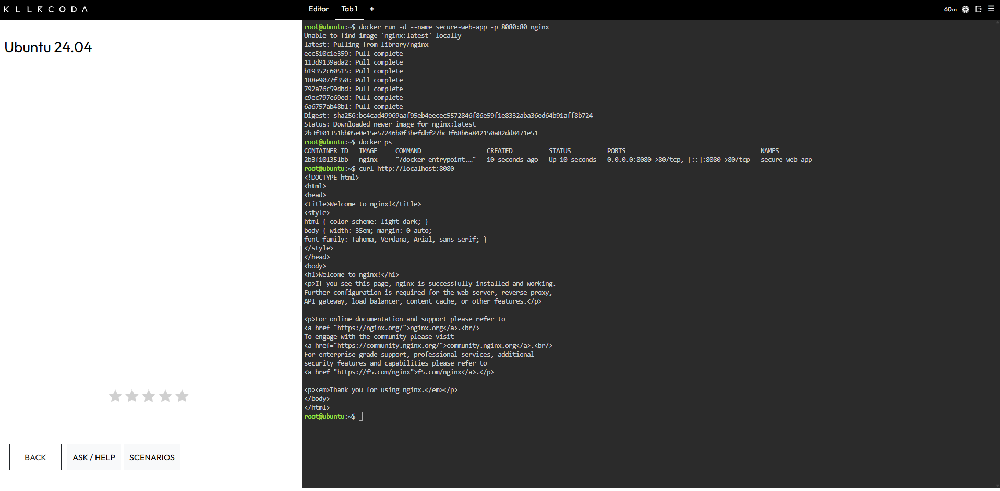
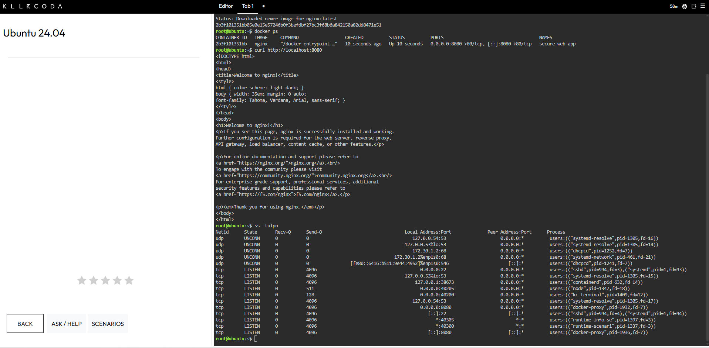
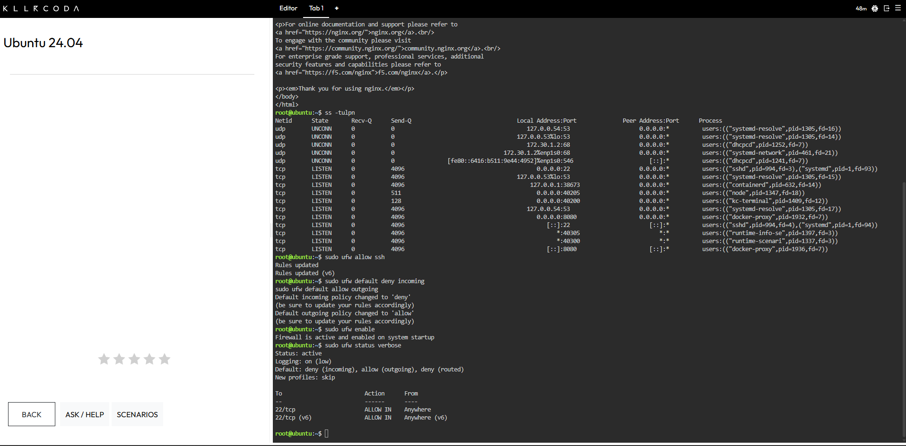
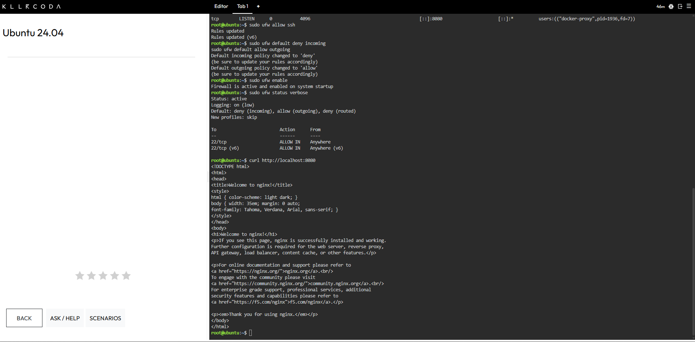
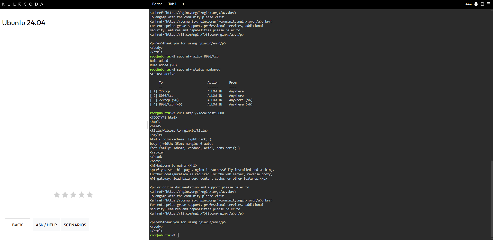

# Laboratory 8: Cloud Security Engineer

**Mission 8: Host-Based Firewall Hardening with UFW**
CCM101 Cloud Computing | University of Eastern Pangasinan

---

## Security Summary

| Field | Details |
| :--- | :--- |
| **Client Scenario** | Ubuntu server deployed for a client's web application with no network security configured |
| **Application** | Nginx container named `secure-web-app` |
| **Published Port** | `8080` mapped to container port `80` |
| **Firewall** | Uncomplicated Firewall (UFW) |
| **Policy** | Default deny incoming, default allow outgoing |
| **Allowed Services** | SSH (port 22) and the web application (port 8080) |
| **Environment** | KillerCoda Ubuntu Playground |
| **Status** | Hardened, verified, and documented |

> [!NOTE]
> The `curl` request to the web application succeeded both before and after the port 8080 rule was added. The request came from the server itself, and Docker publishes its own ports, so the local test does not show what the rule blocks. Details are in [firewall-configuration.md](firewall-configuration.md).

---

## Mission Overview

A junior developer at CloudNova Technologies deployed a new Ubuntu server for a client's web application without configuring any network security. As a member of the Cloud Security Team, I secured the machine by auditing its open ports, enabling the Uncomplicated Firewall (UFW), enforcing a default deny policy for incoming traffic, and opening only the two services the client needs: SSH for remote administration and port 8080 for the web application.

This lab applies the defense in depth principle from Chapter 8. A host-based firewall adds a layer of protection on the server itself, and the lab also showed where that layer has limits when Docker is involved.

---

## Objectives

- Understand the concept of the Attack Surface and the Principle of Least Privilege (PoLP).
- Perform a basic security audit of active network ports on a Linux server.
- Configure the Uncomplicated Firewall (UFW) with a Default Deny policy.
- Implement granular port management to selectively allow SSH and HTTP traffic.
- Document firewall rules and security best practices using Markdown.
- Continue expanding a professional GitHub Cloud Computing Portfolio.

---

## Commands Executed

| Step | Command | What It Did |
| :---: | :--- | :--- |
| 1 | `docker run -d --name secure-web-app -p 8080:80 nginx` | Started an Nginx container named `secure-web-app` in the background and mapped host port 8080 to container port 80. |
| 2 | `docker ps` | Listed the running containers and confirmed that `secure-web-app` was up. |
| 3 | `curl http://localhost:8080` | Sent a request to the web application to confirm it was reachable. |
| 4 | `ss -tulpn` | Listed every TCP and UDP port the server was listening on, with the program behind each one. |
| 5 | `sudo ufw allow ssh` | Added a rule that permits incoming SSH traffic on port 22. |
| 6 | `sudo ufw default deny incoming` | Set the default policy to block all incoming traffic that no rule allows. |
| 7 | `sudo ufw default allow outgoing` | Set the default policy to allow the server's outgoing traffic. |
| 8 | `sudo ufw enable` | Activated the firewall and set it to start at boot. |
| 9 | `sudo ufw status verbose` | Displayed the firewall state, default policies, and rules. |
| 10 | `curl http://localhost:8080` | Tested the web application again while the firewall was active and port 8080 had no rule. |
| 11 | `sudo ufw allow 8080/tcp` | Added a rule that permits incoming TCP traffic on port 8080. |
| 12 | `sudo ufw status numbered` | Listed the firewall rules with numbers to confirm the new rule. |
| 13 | `curl http://localhost:8080` | Tested the web application once more with the 8080 rule in place. |

---

## Key Findings

| Area | Result |
| :--- | :--- |
| **Baseline Ports** | Before hardening, SSH on port 22 and the Docker-published port 8080 were both listening on all addresses. |
| **Firewall State** | UFW was active, with a default deny policy for incoming traffic and a default allow policy for outgoing traffic. |
| **Final Rules** | Four rules were active: SSH and port 8080, each for IPv4 and IPv6. |
| **Test Result** | The web page answered a local request before and after the 8080 rule, so the local test does not show what the rule blocks. |
| **Docker Behavior** | Docker-published ports can skip UFW's rules, so a deny rule alone may not hide such a port from the internet. |

---

## Skills Learned

- Explaining the Principle of Least Privilege, the attack surface, and a default deny policy.
- Auditing the listening ports on a Linux server with `ss -tulpn`.
- Enabling UFW safely by allowing SSH before turning the firewall on.
- Setting default incoming and outgoing policies with UFW.
- Opening a single port with a precise rule and checking it with `ufw status numbered`.
- Recognizing that a test run from the server itself does not prove how outside traffic is handled.
- Learning that Docker-published ports can bypass UFW, and naming ways to close that gap.
- Documenting firewall rules and evidence clearly in Markdown.

---

## Deliverables

| File | Description |
| :--- | :--- |
| [security-audit-report.md](security-audit-report.md) | Defines PoLP, attack surface, and default deny, and records the baseline port audit. |
| [firewall-configuration.md](firewall-configuration.md) | Documents the UFW commands, the final rules, and the Docker observation. |
| [reflection.md](reflection.md) | Mission reflection. |
| `screenshots/` | Evidence of the application, the port audit, and each firewall stage. |

---

## Evidence

**Figure 1.** Application running before hardening

**Figure 2.** Open ports before hardening

**Figure 3.** Firewall activated with the default deny policy

**Figure 4.** Request before the port 8080 rule

**Figure 5.** Port 8080 allowed

