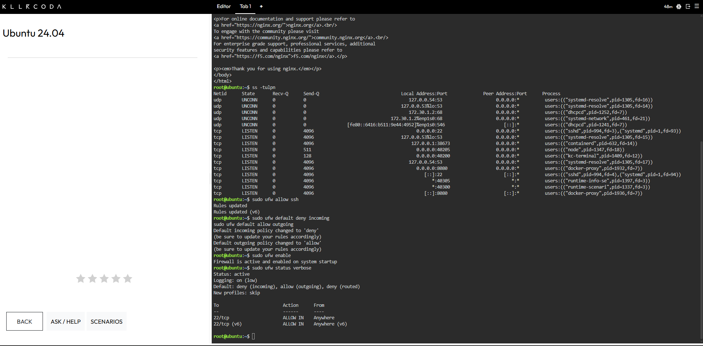
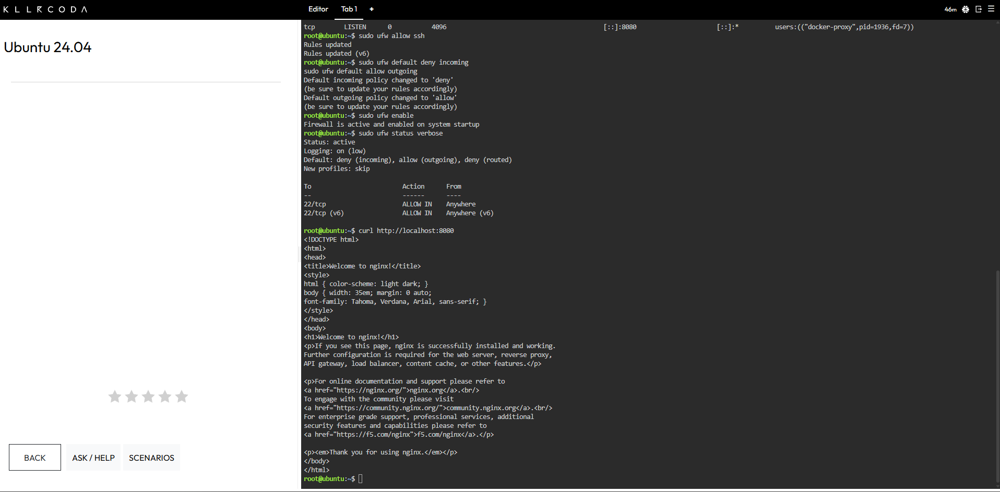
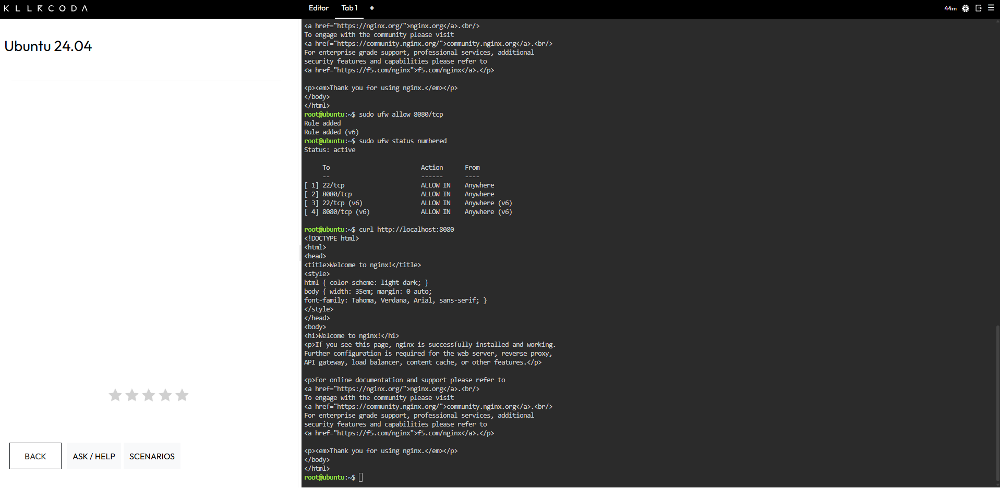

<div align="center">

# Firewall Configuration

**Laboratory 8: Cloud Security Engineer**
CCM101 Cloud Computing | University of Eastern Pangasinan

</div>

---

## Configuration Summary

| Setting | Result |
| :--- | :--- |
| **Firewall** | Uncomplicated Firewall (UFW) |
| **Protected Server** | CloudNova web server running an Nginx container named `secure-web-app` on port 8080 |
| **SSH Access** | Incoming SSH traffic on port 22 is allowed, so administrators can manage the server remotely. |
| **Incoming Policy** | All incoming traffic is denied by default unless a rule allows it. |
| **Outgoing Policy** | All outgoing traffic is allowed by default, so the server can still reach the internet. |
| **Web Application** | Incoming TCP traffic on port 8080 is allowed, so users can reach the application. |
| **Firewall State** | Active, and enabled to start automatically at boot. |

This document records the commands used to secure the server, the order they were applied in, and what the testing showed.

> [!NOTE]
> The web page answered a local `curl` request before the port 8080 rule existed. Section 5 explains why, and what it means for the firewall's protection.

---

## 1. Allow SSH

| Command | What It Did |
| :--- | :--- |
| `sudo ufw allow ssh` | Added a rule that permits incoming SSH connections on port 22 for both IPv4 and IPv6. |

> [!WARNING]
> If `sudo ufw enable` were run before `sudo ufw allow ssh`, the default deny policy would immediately block incoming SSH connections and lock administrators out of the server.

---

## 2. Set the Default Deny Policy

| Command | What It Did |
| :--- | :--- |
| `sudo ufw default deny incoming` | Set the default policy to block every incoming connection that no rule explicitly allows. |
| `sudo ufw default allow outgoing` | Set the default policy to let the server's own outgoing connections through. |

---

## 3. Enable the Firewall and Check Its Status

| Command | What It Did |
| :--- | :--- |
| `sudo ufw enable` | Turned the firewall on and set it to start at boot. |
| `sudo ufw status verbose` | Displayed the firewall state, the default policies, and every active rule. |

Status output after enabling the firewall:

```
Status: active
Logging: on (low)
Default: deny (incoming), allow (outgoing), deny (routed)
New profiles: skip

To                         Action      From
--                         ------      ----
22/tcp                     ALLOW IN    Anywhere
22/tcp (v6)                ALLOW IN    Anywhere (v6)
```

At this point only SSH had an allow rule.

---

## 4. Allow Port 8080

| Command | What It Did |
| :--- | :--- |
| `sudo ufw allow 8080/tcp` | Added a rule that permits incoming TCP traffic on port 8080 for the web application. |
| `sudo ufw status numbered` | Listed every rule with a number, which confirmed that the new rule was added. |
| `curl http://localhost:8080` | Sent a web request to the application with the rule in place. |

Numbered rule list after the change:

```
Status: active

     To                         Action      From
     --                         ------      ----
[ 1] 22/tcp                     ALLOW IN    Anywhere
[ 2] 8080/tcp                   ALLOW IN    Anywhere
[ 3] 22/tcp (v6)                ALLOW IN    Anywhere (v6)
[ 4] 8080/tcp (v6)              ALLOW IN    Anywhere (v6)
```

The `curl` request returned the Nginx welcome page.

---

## 5. Observation: Docker and the Local Test

During testing, the web page answered a `curl` request on port 8080 even before the 8080 rule existed, while the default deny policy was already active. Two factors explain this:

1. The request came from the server itself, and this firewall setup does not normally filter a server's own local traffic.
2. Docker publishes container ports with its own network rules, which can skip the rules that UFW manages. A UFW deny rule alone should not be assumed to hide a Docker-published port from the internet.

Access from outside the server was not tested. This lab shows that the rule is in place, but it does not prove that outside traffic would be blocked without it.

Two common ways to close this gap on a real server are listed below. Neither was tested in this lab.

| Option | How It Helps |
| :--- | :--- |
| **Bind the port to the local address** | Publishing the port as `127.0.0.1:8080:80` makes the container reachable only from the server itself. |
| **Filter in Docker's DOCKER-USER chain** | Docker leaves this chain free for administrator rules, and they are checked before Docker's own rules. |

---

## 6. References

- Baeldung on Linux, an article on why Docker-published ports ignore UFW rules: https://www.baeldung.com/linux/docker-container-published-port-ignoring-ufw-rules
- SSD Nodes, a guide on how Docker ports bypass UFW and how to fix it: https://www.ssdnodes.com/learn/docker-ports-bypass-ufw

---

## 7. Evidence

<div align="center">

**Figure 1.** Firewall activated with the default deny policy



**Figure 2.** Request before the port 8080 rule



**Figure 3.** Port 8080 allowed



</div>
