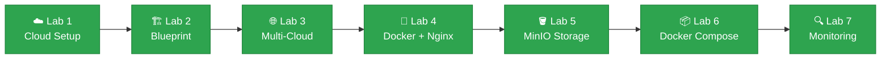

# Carl Emmanuel O. Rabanillo

### **4th-Year Information Technology Student 💻**

**University of Eastern Pangasinan (UEP)**  
**CCM101 - Cloud Computing**  
**Instructor: Cledmar N. Badongen**

 

 

[🚀 About](#about) • [🛠️ Skills](#skills) • [📂 Labs](#labs) • [🗺️ Roadmap](#roadmap) • [💻 Stack](#stack) • [📫 Contact](#contact)

---

## 🚀 About

This repository serves as my professional portfolio and workspace for **CCM101 – Cloud Computing**. It houses all my laboratory activities, Linux configurations, version-controlled scripts, and documentation completed throughout the semester.

Each milestone highlights my continuous growth in:
* ☁️ Cloud Infrastructure & Architecture
* 🌐 Multi-Cloud Platform Comparison (AWS, Azure, GCP)
* 🐧 Linux System Administration & Bash Scripting
* 🐳 Containerization & Infrastructure as Code (Docker, Docker Compose)
* 🔍 Monitoring & Observability (Host Health, Container Logs, and Metrics)
* 📝 Version Control & Technical Documentation

[⬆️ Back to top](#top)

---

## 🛠️ Skills & Technologies

| Category | Technologies |
| :--- | :--- |
| 🖥️ **Operating Systems** | Ubuntu Linux, Debian |
| ☁️ **Cloud Platforms** | Amazon Web Services (AWS), Microsoft Azure, Google Cloud Platform (GCP) |
| 📦 **Cloud & Virtualization** | KillerCoda Playground, KVM |
| 🐳 **Containers & Deployment** | Docker, Docker Compose, Nginx, Nextcloud, MariaDB, MinIO |
| 🔍 **Monitoring** | Linux CLI tools (`free`, `df`, `top`), `docker logs`, `docker stats` |
| 🔀 **Version Control** | Git, GitHub |
| 📝 **Documentation** | Markdown, CLI Workflows |

[⬆️ Back to top](#top)

---

## 📂 Laboratory Activity Tracking

> 💡 **Tip:** Click a lab name to open its folder, or expand a panel below the table for details.

| Milestone | Laboratory Task Description | Status |
| :--- | :--- | :---: |
| **[Lab 1](Laboratory-01-Welcome-to-the-Cloud/)** | Welcome to the Cloud (Linux Setup & GitHub Portfolio) | ✅ Completed |
| **[Lab 2](Laboratory-02-Build-the-Cloud-Infrastructure-Blueprint/)** | Build the Cloud Infrastructure Blueprint (Project ED) | ✅ Completed |
| **[Lab 3](Laboratory-03-Multi-Cloud-Explorer/)** | Multi-Cloud Explorer (AWS, Azure & GCP Research, Comparison, and Client Recommendations) | ✅ Completed |
| **[Lab 4](Laboratory-04-Cloud-Native-Engineer/)** | Cloud-Native Engineer (Docker, Containerization, and Nginx Deployment) | ✅ Completed |
| **[Lab 5](Laboratory-05-Cloud-Data-Engineer/)** | Cloud Data Engineer (Object Storage, MinIO Deployment, and Bucket Management) | ✅ Completed |
| **[Lab 6](Laboratory-06-Cloud-Deployment-Engineer/)** | Cloud Deployment Engineer (Docker Compose, Multi-Tier Architecture, and Nextcloud Deployment) | ✅ Completed |
| **[Lab 7](Laboratory-07-Cloud-Operations-Engineer/)** | Cloud Operations Engineer (Host Baseline, Docker Logs, and Container Metrics Monitoring) | ✅ Completed |

### 🔽 Lab Details

<b>🌱 Labs 1 to 3: Cloud Foundations</b>

 

| Lab | Focus |
| :--- | :--- |
| **Lab 1** | Linux setup and building the GitHub portfolio that holds every later lab. |
| **Lab 2** | Planning a cloud infrastructure blueprint for Project ED. |
| **Lab 3** | Researching and comparing AWS, Azure, and GCP, with recommendations for the client. |

<b>🐳 Labs 4 and 5: Containers and Storage</b>

 

| Lab | Focus |
| :--- | :--- |
| **Lab 4** | Docker and containerization, ending with an Nginx deployment. |
| **Lab 5** | Object storage with a MinIO deployment and bucket management. |

<b>🏗️ Lab 6: Cloud Deployment Engineer</b>

 

**Mission:** Deploy a two-tier private cloud storage system for CloudNova Technologies using Docker Compose.

* 🌐 **Web tier:** Nextcloud container published on port 8080
* 🗄️ **Database tier:** MariaDB container reachable only by Nextcloud
* 📜 **Infrastructure as Code:** one `docker-compose.yml` that deploys and removes the whole stack
* 📄 **Documents:** `multi-tier-architecture.md`, `docker-compose-guide.md`, `reflection.md`

[📁 Open the Lab 6 folder](Laboratory-06-Cloud-Deployment-Engineer/)

<b>🔍 Lab 7: Cloud Operations Engineer</b>

 

**Mission:** Check that a client's web server is ready for a marketing campaign by collecting evidence instead of assuming.

* 🧠 **Host baseline:** memory, disk, and CPU readings
* 📜 **Logs:** three 200 responses and one 404 isolated with `grep`
* 📊 **Metrics:** container CPU, memory, and network use from `docker stats`
* 📄 **Documents:** `system-baseline-report.md`, `container-observability.md`, `reflection.md`

[📁 Open the Lab 7 folder](Laboratory-07-Cloud-Operations-Engineer/)

[⬆️ Back to top](#top)

---

## 🗺️ Learning Roadmap

**Overall progress:** `██████████ 100%` (7 of 7 labs completed)

[⬆️ Back to top](#top)

---

## 💻 Technical Stack

  
  
  
  
  
  
  
  
  
  
  
  
  
  

[⬆️ Back to top](#top)

---

## 📫 Connect & Contact

* **GitHub:** [@MikashitaDezu](https://github.com/MikashitaDezu)
* **Institution:** University of Eastern Pangasinan
